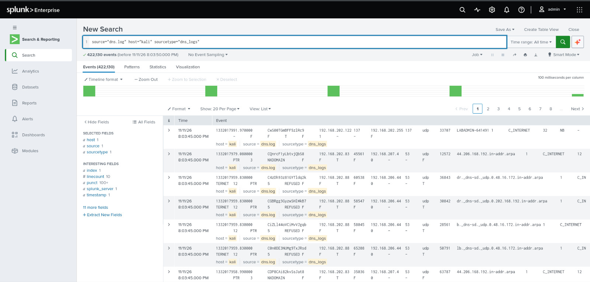
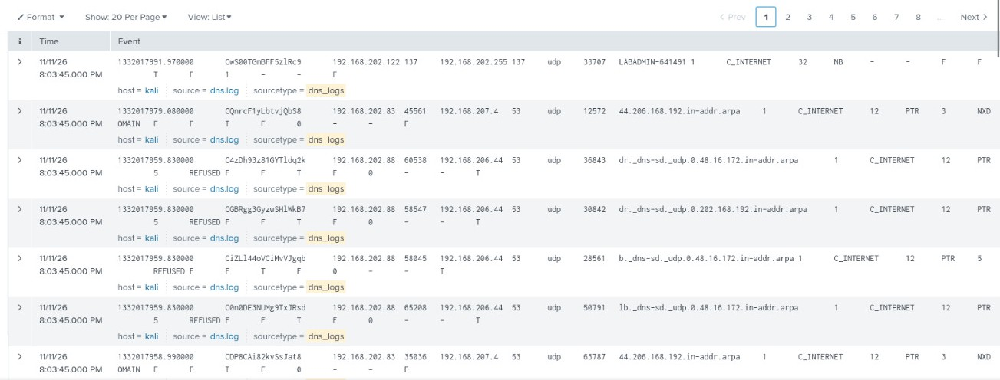
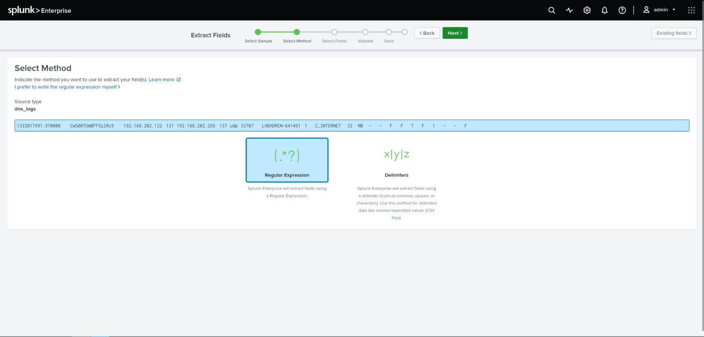
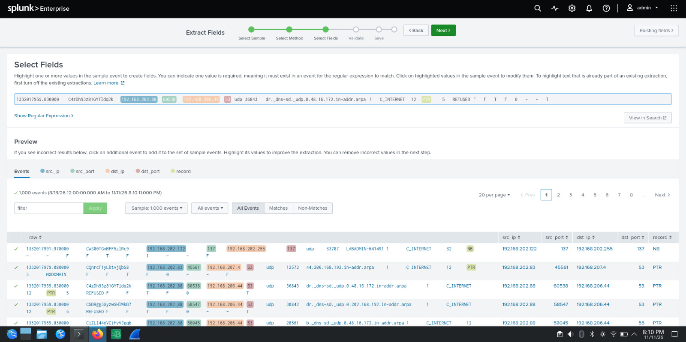
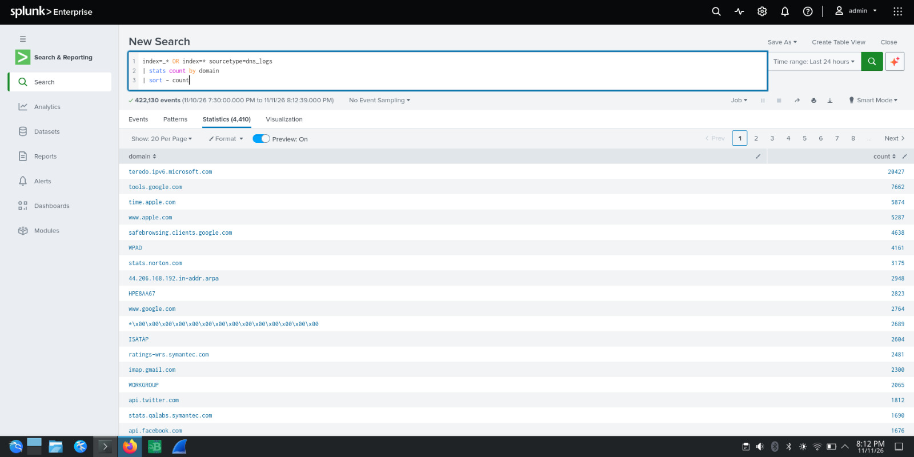
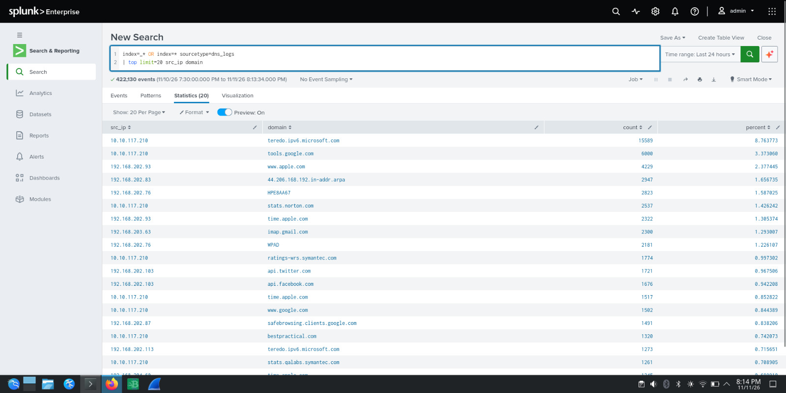
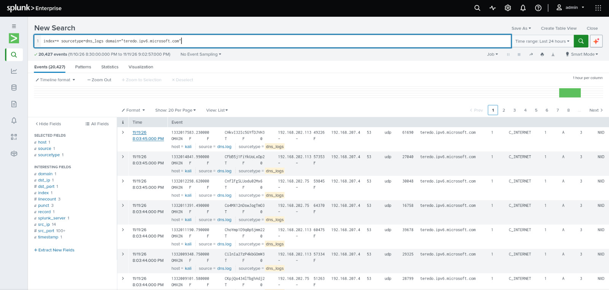
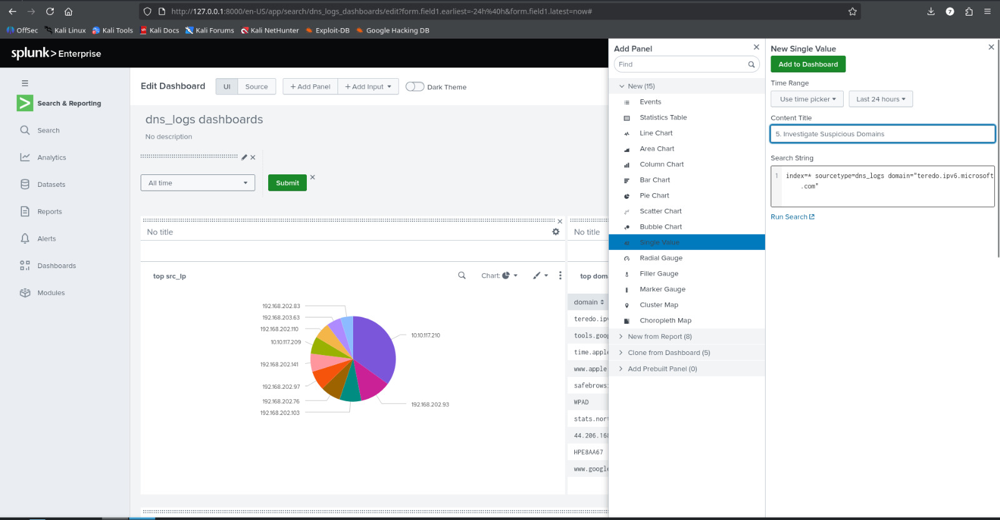
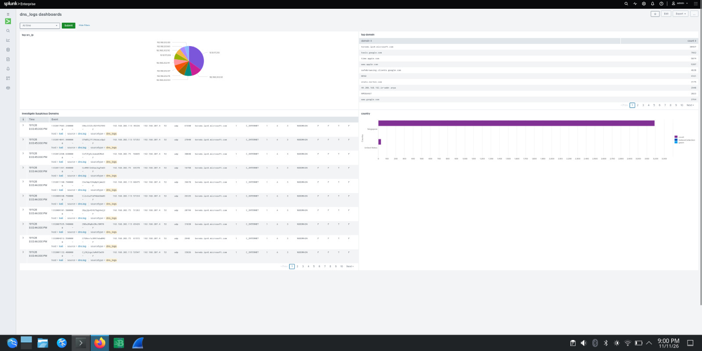

# 🔍 Analyzing DNS Log Files Using Splunk SIEM

A hands-on SOC / blue-team project where I ingested **422,130 DNS log events** into **Splunk Enterprise**, extracted custom fields, hunted for suspicious or noisy domains, and built a custom **DNS monitoring dashboard**.


---

## 📌 Project Overview

DNS is one of the most valuable telemetry sources for a SOC analyst. Nearly every connection starts with a DNS query, so malware beaconing, tunneling, DGA activity and misconfigured hosts all leave traces in it.

In this project I:

- Ingested a Zeek-style `dns.log` file into Splunk as a custom sourcetype (`dns_logs`)
- Extracted fields (`src_ip`, `src_port`, `dst_ip`, `dst_port`, `record`) using Splunk's Field Extractor (regex)
- Wrote SPL queries to find top talkers, top queried domains and unusual traffic
- Investigated a high-volume suspicious domain
- Built a 4-panel dashboard for ongoing DNS visibility

---

## 🛠️ Environment

| Component | Details |
|---|---|
| SIEM | Splunk Enterprise (local, `127.0.0.1:8000`) |
| OS | Kali Linux |
| Data source | `dns.log` |
| Index / Sourcetype | `index=*` / `sourcetype=dns_logs` |
| Host | `kali` |
| Total events | **422,130** |
| Time range | Last 24 hours |

---

## 🧭 Methodology

### 1. Data ingestion & verification
Uploaded `dns.log` and confirmed all events were indexed correctly.

```spl
source="dns.log" host="kali" sourcetype="dns_logs"
```

Result: **422,130 events** with `host`, `source` and `sourcetype` populated.

### 2. Field extraction
The raw log is tab-delimited, so Splunk did not give friendly field names for everything. I used the **Field Extractor (Regular Expression method)** to pull out:

| Field | Meaning |
|---|---|
| `src_ip` | Client making the DNS query |
| `src_port` | Source port |
| `dst_ip` | DNS server queried |
| `dst_port` | Destination port (53 for DNS, 137 for NetBIOS) |
| `record` | DNS record type (A, PTR, NB, ...) |

The extraction was validated on a 1,000-event sample before saving.

### 3. Hunting with SPL

**Top queried domains**
```spl
index=* sourcetype=dns_logs
| stats count by domain
| sort - count
```
Returned **4,410 unique domains**.

**Top source IP / domain pairs**
```spl
index=* sourcetype=dns_logs
| top limit=20 src_ip domain
```

**Drill into the most suspicious domain**
```spl
index=* sourcetype=dns_logs domain="teredo.ipv6.microsoft.com"
```
Returned **20,427 events**.

---

## 📊 Key Findings

### Top 10 queried domains

| # | Domain | Count |
|---|---|---|
| 1 | `teredo.ipv6.microsoft.com` | 20,427 |
| 2 | `tools.google.com` | 7,662 |
| 3 | `time.apple.com` | 5,874 |
| 4 | `www.apple.com` | 5,287 |
| 5 | `safebrowsing.clients.google.com` | 4,638 |
| 6 | `WPAD` | 4,161 |
| 7 | `stats.norton.com` | 3,175 |
| 8 | `44.206.168.192.in-addr.arpa` | 2,948 |
| 9 | `HPE8AA67` | 2,823 |
| 10 | `www.google.com` | 2,764 |

### Observations

- **`teredo.ipv6.microsoft.com` dominates the traffic** (about 4.8% of all events, 20,427 queries). The queries are type `A` and return **NXDOMAIN**, coming from multiple internal hosts (14 distinct source IPs) to the internal resolver `192.168.207.4:53`. Teredo is a Windows IPv6 transition mechanism, so this is most likely benign but very noisy. It is worth tuning out or monitoring, since tunneling protocols can be abused for covert traffic.
- **Top talker:** `10.10.117.210` generated the largest share of queries, including 15,589 lookups of the Teredo domain.
- **Legacy name-resolution traffic:** `WPAD`, `ISATAP`, `WORKGROUP` and NetBIOS (`NB` on UDP/137) queries are present. These are classic targets for WPAD spoofing and LLMNR/NBNS poisoning attacks, so they are worth flagging in a real environment.
- **Reverse lookups (PTR):** Many PTR queries for `*.in-addr.arpa` and `_dns-sd._udp.*` (DNS service discovery) returned `NXDOMAIN` or `REFUSED`.
- **Security-product telemetry:** Lookups for `stats.norton.com` and `ratings-wrs.symantec.com` show endpoint AV software phoning home.
- **Geo view:** Most resolved destinations map to **Singapore**, with a smaller share in the **United States**.

> ⚠️ Note: these are observations from a lab dataset, not confirmed malicious activity. Frequency alone is a starting point for investigation, not a verdict.

---

## 📈 Custom Dashboard: `dns_logs dashboards`

| Panel | Visualization | Purpose |
|---|---|---|
| **Top src_ip** | Pie chart | Which internal hosts generate the most DNS traffic |
| **Top domain** | Statistics table | Most frequently queried domains |
| **5. Investigate Suspicious Domains** | Events list | Drill-down on `teredo.ipv6.microsoft.com` |
| **Country** | Bar chart | Geographic distribution of destinations |

Dashboard built with Splunk's **Dashboard Editor (Classic)**: *Add Panel → New → choose visualization → paste SPL → Add to Dashboard*.

---

## 📸 Screenshots


| Step | Screenshot |
|---|---|
| Data ingestion check |  |
| Events  |  |
| Field Extractor: method |  |
| Field Extractor: select fields |  |
| Top domains (stats) |  |
| Top src_ip / domain pairs |  |
| Teredo investigation |  |
| Building the dashboard |  |
| **Final dashboard** |  |

---

## 🎯 Skills Demonstrated

- Splunk log ingestion and sourcetype configuration
- Field extraction with regex (Field Extractor)
- SPL: `stats`, `sort`, `top`, filtering and drill-down
- DNS protocol analysis (A, PTR, NB records, NXDOMAIN / REFUSED response codes)
- Threat hunting mindset: baselining, spotting anomalies, separating noise from signal
- Dashboard design for SOC monitoring

---

## 🚀 How to Reproduce

1. Install **Splunk Enterprise** (free trial) on Kali / any Linux box.
2. Go to **Settings → Add Data → Upload** and upload `dns.log`.
3. Set the sourcetype to `dns_logs`.
4. Open **Search** and run `index=* sourcetype=dns_logs`.
5. Use **Extract New Fields → Regular Expression** to create `src_ip`, `src_port`, `dst_ip`, `dst_port`, `record`.
6. Run the SPL queries above.
7. Create a dashboard: **Dashboards → Create New Dashboard → Add Panel**.

---

## 🔮 Future Improvements

- Detect **DNS tunneling** using query length and entropy (`eval len(query)`, `stats avg`)
- Detect **DGA domains** and high NXDOMAIN ratios per host
- Add a threat-intel lookup (e.g. VirusTotal or a blocklist CSV) for domain reputation
- Create Splunk **alerts** for spikes in NXDOMAIN or rare TLDs
- Correlate DNS with Wazuh / Sysmon endpoint events

---

## 👤 Author

**Saranjith R**
B.E. Computer Science (Cyber Security) · ISC2 Certified in Cybersecurity (CC)
GitHub: [@SARANJITH02](https://github.com/SARANJITH02)

---

## 📄 License

This project is for educational purposes. Feel free to use it as a reference.
